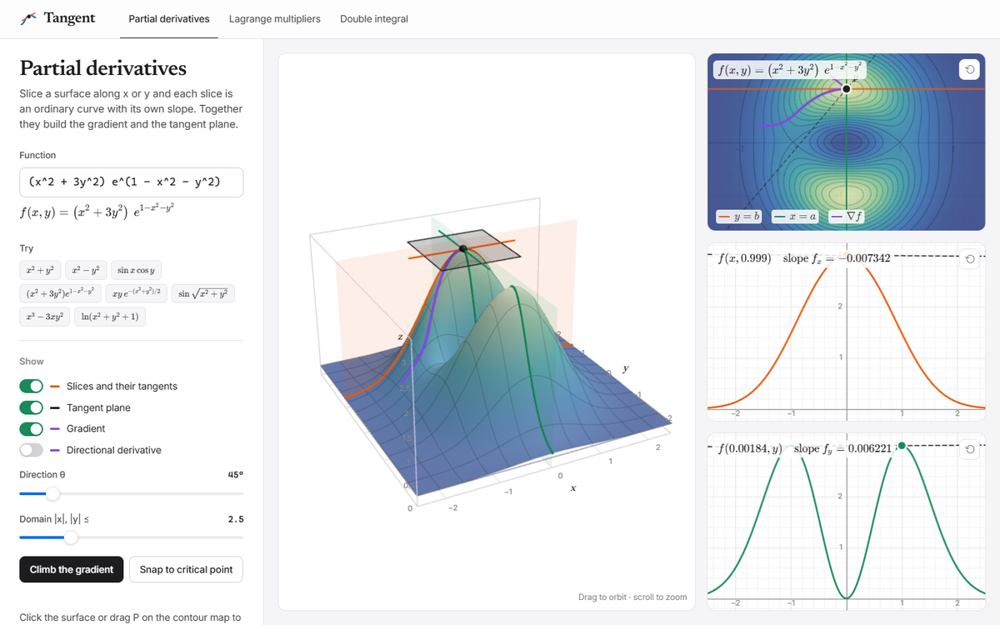
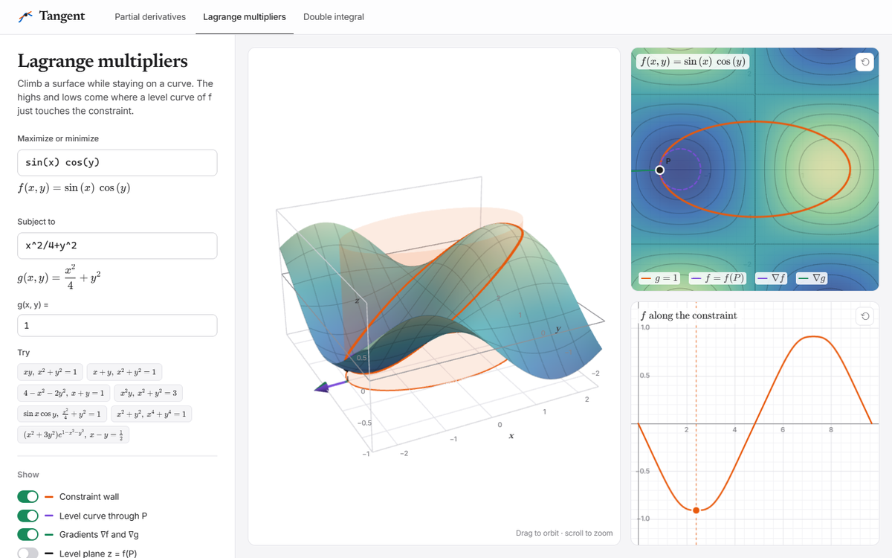
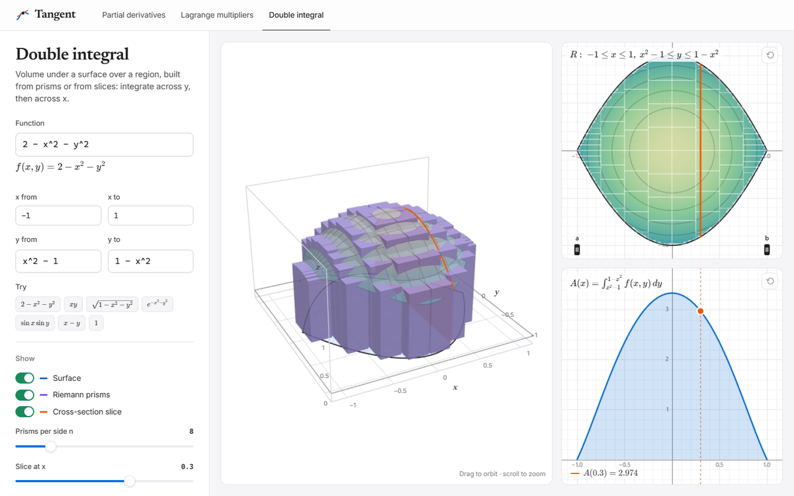

# Tangent

**Multivariable calculus you can see.** Type any function of x and y and explore it in 3D: slice it, climb its gradient, pin it to a constraint, or fill the volume underneath with prisms.



## What's inside

### Partial derivatives

Slice the surface along x and along y. Each slice is an ordinary curve with its own tangent line, and together they make the tangent plane.

- Orange and green slice planes with their tangent lines, the tangent plane, the gradient arrow and a directional derivative at any angle
- A contour map and the two slice graphs, all linked to one draggable point P (or click the surface)
- **Climb the gradient**: P climbs the steepest path, leaving a trail, until it reaches a peak
- **Snap to critical point**: jumps to the nearest place where the surface is flat

### Lagrange multipliers



Maximize f(x, y) while staying on a curve g(x, y) = c.

- The constraint becomes a wall through the surface, and the curve where they meet is lifted onto it
- The level curve of f through P, with ∇f and ∇g drawn at P
- A graph of f along the constraint, whose peaks and dips are the constrained extremes
- **Walk the constraint** and **Snap to a tangency** (where a level curve just touches the constraint and the two gradients line up)

### Double integral



Volume under f over any region a ≤ x ≤ b, g₁(x) ≤ y ≤ g₂(x).

- Riemann prisms (purple above zero, orange below), a moving cross-section, and a top-down map of the region
- The cross-section area A(x), whose shaded area is the double integral
- **Sweep the slice** across the region and **Grow the prisms** from 1 to 40 per side

The side panels deliberately show no computed answers. The page is for exploring, not for checking homework.

## Typing functions

Input is forgiving:

| You type | Read as |
| --- | --- |
| `2xy`, `x y` | 2·x·y, x·y |
| `sin x`, `xcos y` | sin(x), x·cos(y) |
| `ln(x)`, `e^x`, `exp(x)` | natural log, eˣ |
| `\|x\|` | abs(x) |
| `x²`, `π`, `√(x)` | x^2, pi, sqrt(x) |

Also available: `sqrt`, `cbrt`, `sec`, `csc`, `cot`, the inverse trig functions (`asin` or `arcsin` …), hyperbolic functions, `floor`, `ceil`, `min` and `max`.

Every view is saved in the URL, so you can share a link to exactly what you're looking at.

## Getting started

You need [Node.js](https://nodejs.org) 20.19 or newer.

```bash
npm install
npm run dev
```

Then open http://localhost:5360.

| Script | What it does |
| --- | --- |
| `npm run dev` | Dev server on port 5360 |
| `npm run build` | Production build into `dist/` |
| `npm run preview` | Serve the production build |
| `npm run check` | Double integrals, partial derivatives and traced curves against known answers |
| `npm run smoke` | Clicks through every page in headless Chrome and fails on any console error (needs the dev server running and Chrome or Edge installed; set `CHROME_PATH` if it isn't found) |

## How it works

```
src/
  main.js            page shell, navigation, URL state
  modes/             one file per page: partial, lagrange, double
  math/
    expr.js          tidies input, parses it with math.js, compiles it to a fast JS function, symbolic derivatives
    numeric.js       adaptive Gauss–Kronrod integration
    isolines.js      traces level curves with marching squares, then snaps each point onto the true curve
  plot/
    plot3d.js        three.js surface view: z-up box, clipping, fat lines, prisms, walls
    plot2d.js        pannable, zoomable canvas graphs with draggable handles
    contour.js       heat map and contour lines
  ui/                controls, KaTeX helpers, animation helpers
tools/               math checks, smoke test, screenshot script
```

Built with [three.js](https://threejs.org), [math.js](https://mathjs.org), [KaTeX](https://katex.org) and [Vite](https://vitejs.dev). There's no framework, just plain JavaScript modules.
